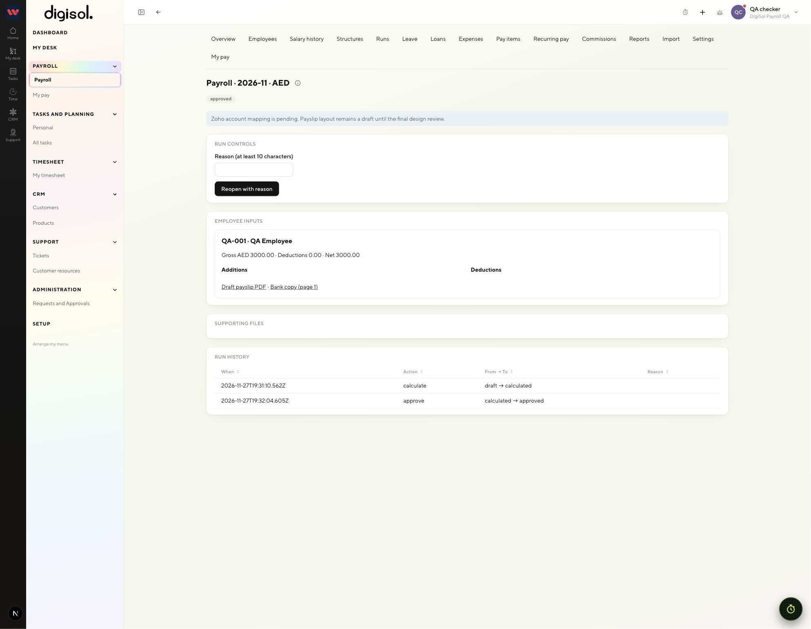
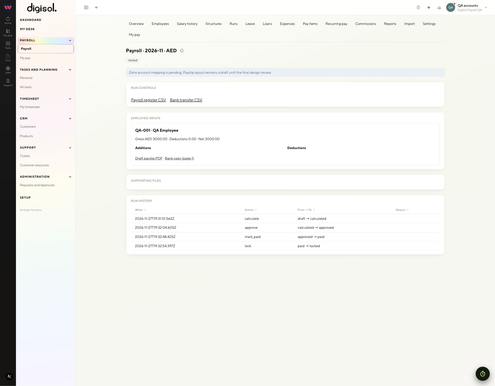
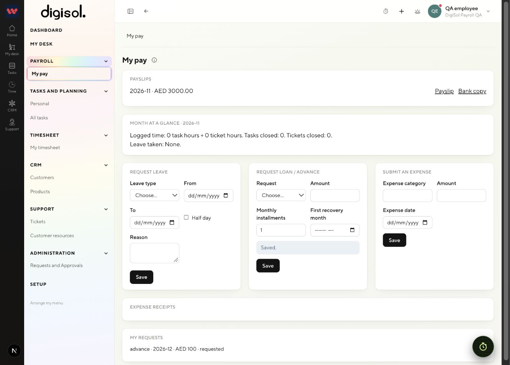

# Payroll QA — 28 November 2026 (Asia/Karachi)

## Automated checks

- PASS: full suite, **119 files / 1,009 tests** (`full-tests.log`). This includes the supplied 49 engine tests, payroll integration and isolated database regressions, existing application tests and API tests.
- PASS: full repository ESLint, workspace typecheck (web/root/shared/API) and production build (`checks.log`).
- PASS: runtime dependency audit: **0 vulnerabilities**. Mongoose is updated within major 9; ExcelJS uses a patched, scoped UUID override.
- PASS: final source manifest: 64 source/config/test files unchanged throughout the final QA run.
- PASS: Zod 4 nested defaults, decimal half-away-from-zero rounding, large safe integer arithmetic and explicit minor-unit persistence.

## Database and access coverage

Tests use only a task-owned loopback MongoDB replica set on port 27029. Test helpers force isolated `coex_test_*` database names. Coverage includes tenant/module/role denials, prohibition on self-granting salary access, immutable assignments, approved bank snapshots, independent approvers, required recalculation after intervening changes, over-limit item approvals, concurrent/idempotent payment retries, transaction rollback, own-payslip projection, paid/locked immutability, recurring items/overrides, commission receipt caps, actual-paid clawbacks, held-item carry-forward, inactive plans, explicit refusal of implicit FX conversion, Excel preview/atomic apply/retry and text bank identifiers.

The owned test container is stopped after QA and retains only disposable local data. The local web QA server is stopped. Other applications/containers and production services were not restarted or modified.

## Browser workflow

Verified in the in-app browser at `http://localhost:3101` against a separate synthetic `coex_test_payroll_browser` database:

1. HR signs in and calculates November payroll: gross/net AED 3,000.
2. A distinct named approver signs in and approves; HR has no self-approve control.
3. Accounts records the synthetic reference `QA-NO-MONEY-TRANSFER`, marks paid and locks the run. No money is transferred.
4. Employee signs in: only My pay is shown in the Payroll menu. The paid own payslip downloads successfully.
5. Employee directly opens the employee-list URL and is redirected with `denied=payroll.read.all`.
6. Employee submits a synthetic AED 100 advance for December in two installments; the saved request retains the selected `advance` subtype.

No real staff record, production credential, email or external bank action was used. This is desktop local acceptance, not a claim of mobile/device/production acceptance.

## Visual evidence

The downloaded synthetic PDF was rendered to `payslip-page-1.png` and `payslip-page-2.png` and visually inspected. Text and amounts are readable without clipping/overlap. Unit/database verification also checks two-page employee output and one-page Bank copy. This is a **provisional draft layout**, not final brand/design or bank acceptance.

## Release boundaries

Zoho account confirmation remains pending; journal export is blocked and no accounting posting occurs. Final payslip design/content and stamp/signature review remain last, after full-module rollout, per owner instruction. Country packs, People/Recognition scorecards and automatic FX conversion are later scope.

No push, CI run, deployment, live tenant enabling, production migration or real email delivery occurred. A separate midnight manual writer's three existing `docs/manual/` changes are preserved and excluded from this Payroll commit; historical outputs and private environments are also preserved.
