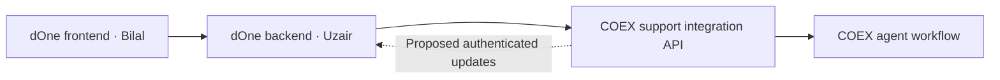

# Project plan

## Confirmed by John

- dOne is a separate web application; Support is required on the web only.
- Customers should raise support requests in dOne; COEX should create/manage the tickets and return their public conversation to dOne.
- Separate frontend and backend so Bilal owns frontend and Uzair owns backend.
- Another team member needs a comprehensive, beginner-friendly deployment guide, tested against the actual environment.
- End-to-end implementation starts once the team installs dOne locally and John provides access.

## Proposed architecture — to validate against dOne

Only the backend holds integration credentials. COEX independently enforces tenant, organisation and contact scope. Do not share databases or accept browser-provided customer identity as authority. Reuse COEX portal business rules without turning a staff API key into customer authorisation.

Current COEX decision: contacts see only their own tickets. Carry this as the integration baseline; company-wide visibility requires a new explicit decision and permission design. Existing portal pages/actions do not constitute a ready external SSO API.

## Delivery phases

1. **Discover:** inspect both dOne repositories, instructions, stack, authentication, tenancy and hosting. Map local services and databases without exposing credentials. Record versions and actual commands.
2. **Agree contract:** identity mapping, authentication method, endpoints, data shapes, upload rules, errors and update transport. Short-lived signed identity assertions and authenticated webhooks are proposals, not selected technology yet.
3. **First journey:** authenticated dOne user raises a ticket; COEX agent replies; same user sees reply in dOne. Enforce own-ticket access at every operation.
4. **Complete UI:** search/filter/pagination, images and attachments, paste previews, notifications, empty/error/retry states. Start with mocks so frontend work can proceed independently.
5. **Verify and hand over:** isolation/security tests, browser journeys, frontend/backend setup guides and beginner deployment rehearsal. Keep implemented, tested, pushed and deployed statuses separate.

## Pending discovery

Repository paths; frameworks/versions; separate processes/builds; user and clinic identifiers; single/multi-tenant model; COEX tenant selection; hosting/OS; domains; secret management; network reachability; storage; notification transport; CI; backups; release permissions and rollback strategy.

No production push or deployment is authorised merely by this plan. Obtain explicit release instructions once a concrete reviewed release is ready.
